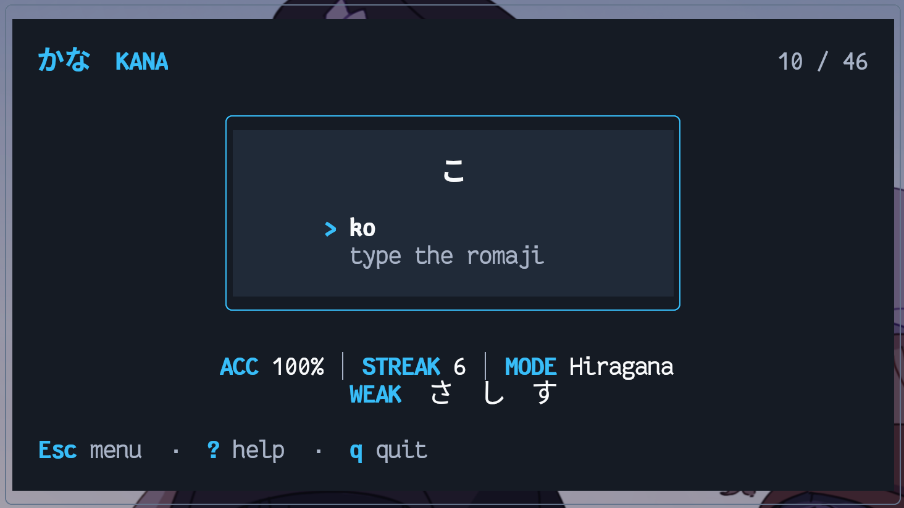

# kana

`kana` is a keyboard-first terminal trainer for learning the 46 basic Japanese kana. Short adaptive sessions revisit weak characters and common confusions.



## Why KANA?

The name is literal: kana is the writing system the program trains. In Japanese, `かな` can also carry the feeling of “I wonder…”, matching the pause before answering a card. Its quiet visual mood takes a small cue from introspective yuri stories such as *Bloom Into You*; it is not connected to the franchise.

## Features

- Hiragana, katakana, and mixed practice
- Adaptive review of weak kana and common confusions
- Automatic local progress saving
- Keyboard-first terminal interface

## Build and run

Go 1.24 or newer is required.

```bash
go build -o kana ./cmd/kana
./kana
```

Built with Go, [Bubble Tea](https://github.com/charmbracelet/bubbletea), [Bubbles](https://github.com/charmbracelet/bubbles), and [Lip Gloss](https://github.com/charmbracelet/lipgloss).
